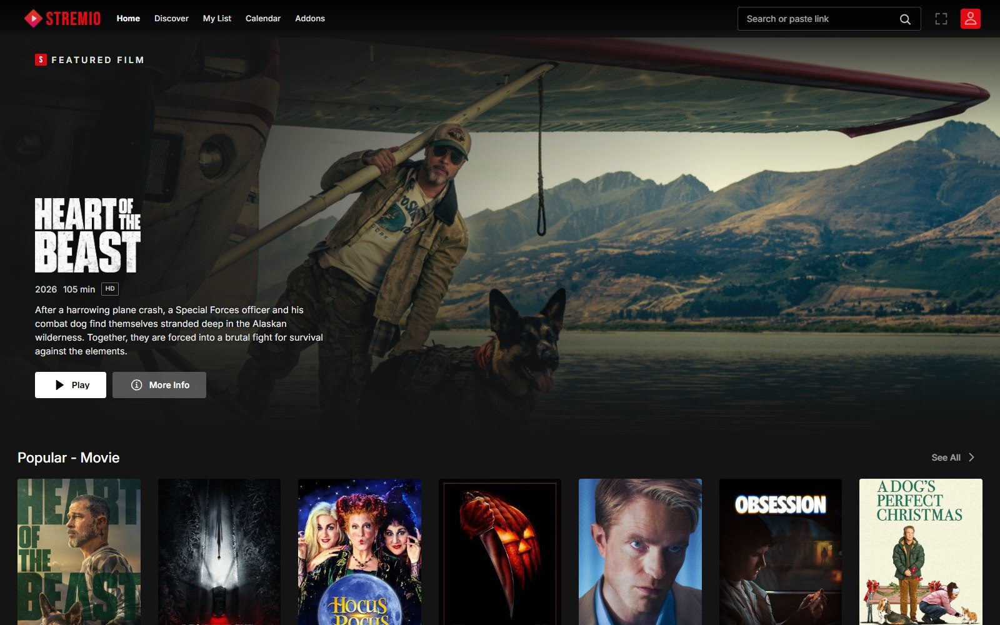
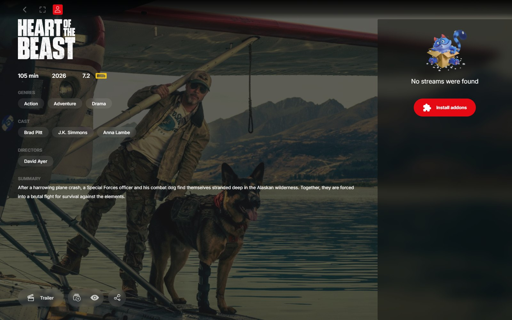
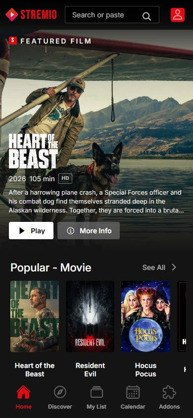

<div align="center">

# Stremio · Netflix Edition

**A Netflix-inspired interface for [Stremio Web](https://github.com/Stremio/stremio-web) — same Stremio engine, same addons, same library, new look.**

[](https://github.com/adishsrivastava/stremio-netflix/actions/workflows/build.yml)
[](LICENSE.md)
[](https://adishsrivastava.github.io/stremio-netflix/development/)

[Hosted preview](https://adishsrivastava.github.io/stremio-netflix/development/) · [Report an issue](https://github.com/adishsrivastava/stremio-netflix/issues) · [Upstream Stremio Web](https://github.com/Stremio/stremio-web)

</div>



This fork restyles the Stremio Web client with a Netflix-like dark interface: a billboard-style hero on the board, a red `STREMIO` wordmark, top navigation tabs, a cinematic content grid, and adapted mobile navigation. It does **not** replace Stremio's backend, player, addon system, or account features — everything Stremio does still works the same way.

| Desktop details | Mobile |
|---|---|
|  |  |

---

## Contents

- [What is Stremio?](#what-is-stremio)
- [What is Torrentio?](#what-is-torrentio)
- [How Stremio and Torrentio work together](#how-stremio-and-torrentio-work-together)
- [Use the hosted preview](#use-the-hosted-preview)
- [Run it locally](#run-it-locally)
- [Install Torrentio](#install-torrentio)
- [Playback and the streaming server](#playback-and-the-streaming-server)
- [Install as an app (PWA)](#install-as-an-app-pwa)
- [What changed in this fork](#what-changed-in-this-fork)
- [Development](#development)
- [Deployment](#deployment)
- [Troubleshooting](#troubleshooting)
- [Legal and attribution](#legal-and-attribution)

---

## What is Stremio?

[Stremio](https://www.stremio.com) is a media center for movies, series, live TV, and other video content. Instead of hosting a catalog itself, Stremio is a client: it loads catalogs and stream links from **addons**, then uses its built-in player to play the stream you choose. A Stremio account optionally syncs your library, watch progress, and installed addons across devices.

The official web client lives at [web.stremio.com](https://web.stremio.com). This repository is a themed fork of its source code.

## What is Torrentio?

[Torrentio](https://torrentio.strem.fun) is a popular third-party Stremio addon. For a movie or episode, it searches public torrent indexes and returns a list of available streams, with quality, seeders, and file size. It can also be configured to return **direct download links from a debrid service** (Real-Debrid, AllDebrid, Premiumize, and others).

Torrentio is not bundled with this project and is not operated by Stremio or by this fork. It does not host video files; it only returns links. Availability, legality, and safety of third-party sources are outside this project's control.

## How Stremio and Torrentio work together

1. Stremio loads **catalogs** (what to browse) and **streams** (what to play) from installed addons.
2. Torrentio is a stream addon. When you open a title, Torrentio contributes torrent or debrid links to the stream list.
3. You pick a stream, and the Stremio player plays it.

There is one important browser detail: a web page cannot download a torrent by itself. For **torrent** streams, Stremio Web needs a **streaming server** running on your machine (the Stremio desktop app and Stremio Service provide one). The server downloads the torrent and serves it to the player over HTTP. **Debrid/direct HTTP streams** generally play without that server.

## Use the hosted preview

The `development` branch is built and published automatically:

**https://adishsrivastava.github.io/stremio-netflix/development/**

Open the link, sign in or use guest mode, then install Torrentio as described below. The hosted build is served over HTTPS; see [Playback and the streaming server](#playback-and-the-streaming-server) for browser limitations when connecting to a local torrent server.

## Run it locally

Requirements: **Node.js 22+** and **pnpm 11+**. The repository pins pnpm through Corepack.

```bash
git clone git@github.com:adishsrivastava/stremio-netflix.git
cd stremio-netflix
corepack enable
corepack pnpm install
corepack pnpm start
```

Then open **https://localhost:8080** and accept the self-signed development certificate. The dev server uses HTTPS by default.

To produce a static production build:

```bash
corepack pnpm build
npx http-server build -p 8080
```

Then open **http://localhost:8080**. Because the app uses hash routing, any static file server works; no rewrite rules are required.

## Install Torrentio

You can use Torrentio with either the hosted preview or a local build.

1. Open the Torrentio configurator: **https://torrentio.strem.fun/configure**
2. Choose the providers, quality preferences, and optional debrid service you want.
3. Copy the generated **install/manifest URL** (it ends in `manifest.json`).
4. In Stremio, open **Addons → Add addon** (the `+` button).
5. Paste the manifest URL and confirm.
6. Open any movie or episode and choose a Torrentio stream from the stream list.

If you just want the default configuration, the plain manifest is:

```text
https://torrentio.strem.fun/manifest.json
```

The configurator is the better path: it lets you add a debrid key for direct HTTPS playback and filter out sources you do not want.

> Tip: after installing, the addon's details page has a **Configure** action that opens the Torrentio configurator for that installation.

## Playback and the streaming server

Stremio Web talks to a **streaming server** for torrent playback. The usual local address is:

```text
http://127.0.0.1:11470
```

The app's built-in default is `http://localhost:11470`. If yours listens elsewhere, add it in **Settings → Streaming → Add URL**, or launch the app with the query parameter:

```text
https://localhost:8080/?streamingServerUrl=http://127.0.0.1:11470
```

Browser rules matter here:

- A page served over **HTTPS** (including the GitHub Pages preview) may be blocked from calling an **HTTP** server on your machine as mixed content.
- Even with matching schemes, the streaming server must send **CORS** headers that allow the app's origin. A server that only allows `web.stremio.com` will reject this fork's origin.
- A self-hosted server therefore needs HTTPS and an explicit CORS allow-list for the address you use.
- Debrid links returned by Torrentio are direct HTTPS URLs and avoid the local torrent server entirely.
- For the most reliable torrent playback, use the **Stremio desktop app**, or run this build locally against a streaming server configured to allow its origin.

| Setup | Torrent streams | Debrid / direct streams |
|---|---|---|
| Local build + a CORS-enabled local streaming server | Works when the server allows the app origin | Works |
| Hosted HTTPS preview + a local HTTP streaming server | Usually blocked by mixed content/CORS | Works |
| Stremio desktop app | Works | Works |

## Install as an app (PWA)

The web client is a PWA and can be installed like a native app:

- **Chrome / Edge (desktop):** open the preview or your local build, then use the install icon in the address bar or **Menu → Install Stremio Web**.
- **Android (Chrome):** **Menu → Add to Home screen → Install**.
- **iPhone / iPad (Safari):** **Share → Add to Home Screen**.

The PWA manifest, theme color (`#141414`), and icons are included in the repository. Installing the hosted preview gives you a standalone window without browser chrome; the same playback caveats above still apply.

## What changed in this fork

The fork is a **presentation-layer theme**. Stremio's routes, addon protocol, account sync, library, player, subtitles, and casting are untouched.

- Netflix-style palette: `#141414` background, `#e50914` accent, white/gray action buttons.
- Billboard hero on the board using catalog `background`, `logo`, description, year/runtime, rating, and genres.
- Desktop top navigation with **Home**, **Discover**, **My List**, **Calendar**, and **Addons** tabs; the left rail is hidden on wide screens and the bottom bar remains on mobile.
- Red `STREMIO` wordmark and a compact top bar with search and profile menu.
- Content cards use a lift shadow on hover; a white ring is reserved for keyboard focus and selection.
- Referenced navigation labels **Board → Home** and **Library → My List**; their routes and behavior are unchanged.
- Inter for UI text and Bebas Neue for the wordmark, both bundled in `assets/fonts/` under the SIL Open Font License.

The theme tokens live in [`src/App/styles.less`](src/App/styles.less). The hero is implemented in [`src/routes/Board/BoardHero`](src/routes/Board/BoardHero).

## Development

| Command | What it does |
|---|---|
| `corepack pnpm start` | HTTPS dev server on port 8080 |
| `corepack pnpm build` | Production build into `build/` |
| `corepack pnpm test` | Jest tests, including translation-key scan |
| `corepack pnpm lint` | ESLint over `src/` |
| `corepack pnpm scan-translations` | Reports hardcoded JSX strings |

The project uses webpack, React, LESS, and TypeScript for selected components. Source lives in `src/`; static assets live in `assets/`.

## Deployment

GitHub Actions workflows are included:

- **Build** (`.github/workflows/build.yml`) runs install, build, test, and lint on pushes and pull requests to `development`, then publishes a preview from `build/` to the `gh-pages` branch under the branch name.
- **Publish GitHub Pages** (`.github/workflows/pages.yml`) deploys the accumulated `gh-pages` content.

To publish from your own fork, enable **Settings → Pages → Build and deployment → Source: GitHub Actions**. The preview for this branch is served at:

```text
https://<your-user>.github.io/stremio-netflix/development/
```

The production build uses relative asset paths, so it also works when hosted under a subpath.

## Troubleshooting

| Symptom | Likely cause and fix |
|---|---|
| Stuck on a blank or old screen | A service worker is serving a cached build. Hard-reload (`Ctrl+Shift+R`), or unregister the service worker in DevTools → Application. |
| "No streams were found" | Torrentio is not installed or is misconfigured. Reinstall it and check provider/debrid settings. |
| Streams appear but playback fails | The streaming server is not running, is unreachable, or rejects the app's origin with CORS. See [Playback and the streaming server](#playback-and-the-streaming-server). |
| Hosted preview cannot reach `127.0.0.1:11470` | Mixed content (HTTPS page → HTTP server). Use the local build, a debrid stream, or Stremio Desktop. |
| Torrentio does not appear after install | Confirm the pasted URL ends in `manifest.json` and is the full generated URL. |
| Fonts or icons look wrong after an update | Clear the site cache/service worker and reload. |

## Legal and attribution

This is an unofficial, community-themed fork. It is **not affiliated with, endorsed by, or sponsored by Netflix, Inc.** "Netflix" is a trademark of Netflix, Inc.; no Netflix logos, artwork, or other proprietary assets are included. The visual design is an original interpretation of a dark streaming interface.

Only stream content you have the legal right to access. Torrentio and other third-party addons are not part of this repository and are used at your own risk; this project does not host, index, or distribute media.

This project is a modified version of [Stremio Web](https://github.com/Stremio/stremio-web), copyright © 2017–2026 [Smart Code OOD](https://www.stremio.com), and is distributed under the **GPL-2.0** license. See [LICENSE.md](LICENSE.md) for the full text. Modified source is available in this repository.

Bundled fonts: [Inter](https://github.com/rsms/inter) and [Bebas Neue](https://github.com/dharmatype/Bebas-Neue), both under the SIL Open Font License; their license files are in `assets/fonts/`.
